<div align="center">



<br/><br/>

<a href="https://razeltech.github.io/">
  
</a>

# RAZEL TECH
### Principal Systems Architecture &amp; Real-Time Engineering Studio

**RAJA VAMSI DHAR V**  
Founder &amp; Chief Executive Officer // Principal Systems Architect  
*MSME Registered Enterprise &bull; Government of India*

[](https://razeltech.github.io/)
[](https://razeltech.github.io/)
[](https://razeltech.github.io/)
[](https://razeltech.github.io/)
[](https://razeltech.github.io/)

<p align="center">
  <strong>Bridging mission-critical defense hardware integration, real-time spatial computing, and zero-compromise resilient software architecture. Delivering high-throughput tactical simulators, WebGL graphics pipelines, and air-gapped clinical intelligence systems.</strong>
</p>

<p align="center">
  <a href="https://razeltech.github.io/"><strong>[ Engineering Portal ]</strong></a> &nbsp;&bull;&nbsp;
  <a href="#executive-mission-profile"><strong>[ Mission Profile ]</strong></a> &nbsp;&bull;&nbsp;
  <a href="#featured-production-architectures"><strong>[ Featured Architectures ]</strong></a> &nbsp;&bull;&nbsp;
  <a href="#core-technical-competencies"><strong>[ Technical Competencies ]</strong></a> &nbsp;&bull;&nbsp;
  <a href="#institutional-inquiries"><strong>[ Contact &amp; Transmission ]</strong></a>
</p>

---

</div>

## Executive Mission Profile

Razel Tech is an MSME-certified advanced software engineering firm led by **Raja Vamsi Dhar V**, specialized in designing and deploying high-integrity real-time systems. With over twelve years of end-to-end architecture experience, Razel Tech engineers mission-critical tactical simulators for defense applications, hardware-in-the-loop (HIL) motion platforms, high-performance WebGL spatial computing engines, and zero-cloud offline-first Progressive Web Applications for enterprise healthcare and data sanitization.

Every system is constructed under rigorous engineering boundaries: zero speculative overhead, deterministic state management, memory-disciplined lifecycle management, and absolute data sovereignty.

---

## Institutional System Metrics

<table width="100%">
  <thead>
    <tr>
      <th width="28%" align="left">Dimension</th>
      <th width="42%" align="left">Operational Metric</th>
      <th width="30%" align="left">Verification Level</th>
    </tr>
  </thead>
  <tbody>
    <tr>
      <td><strong>Industry Tenure</strong></td>
      <td>12+ Years Real-Time Systems Architecture &amp; Delivery</td>
      <td><code>ESTABLISHED LEADERSHIP</code></td>
    </tr>
    <tr>
      <td><strong>Defense Projects</strong></td>
      <td>10+ High-Consequence Tactical &amp; Hardware Simulators</td>
      <td><code>PRODUCTION VERIFIED</code></td>
    </tr>
    <tr>
      <td><strong>Active Platforms</strong></td>
      <td>25+ WebGL, PWA, SaaS, and Digital Twin Deployments</td>
      <td><code>GLOBALLY ACCESSIBLE</code></td>
    </tr>
    <tr>
      <td><strong>Regulatory Status</strong></td>
      <td>MSME Registered Enterprise (Government of India)</td>
      <td><code>LEGALLY CERTIFIED</code></td>
    </tr>
    <tr>
      <td><strong>Core Specialization</strong></td>
      <td>Unity 3D, HLA/RTI, WebGL / Three.js, React, W3C IndexedDB</td>
      <td><code>FULL-STACK MASTERY</code></td>
    </tr>
  </tbody>
</table>

---

## Featured Production Architectures

<table width="100%">
  <tr>
    <td width="50%" valign="top">
      <h3>MEDIC — Family Medicine Guardian</h3>
      <code>DOMAIN: OFFLINE-FIRST CLINICAL PWA</code>
      <br/><br/>
      A resilient, 100% air-gapped healthcare PWA engineered for Indian multi-generational households. Incorporates an interactive monthly calendar dose adherence engine, 145+ PMBJP Jan Aushadhi generic formulations, two-way brand-to-salt matching, natural Indian cadence voice read-aloud (EN/HI/TE), on-device packaging OCR, and 1-tap WhatsApp pharmacy refills. Zero cloud dependencies, zero surveillance.
      <br/><br/>
      <a href="https://razeltech.github.io/medic/"><strong>[ Launch Live PWA ]</strong></a> &bull; 
      <a href="https://github.com/razeltech/medic"><strong>[ Source Repository ]</strong></a>
    </td>
    <td width="50%" valign="top">
      <h3>Chess Arena 3D — Grandmaster WebGL</h3>
      <code>DOMAIN: SPATIAL COMPUTING &amp; WEBRTC MULTIPLAYER</code>
      <br/><br/>
      A tournament-grade 3D chess environment built with Three.js WebGL, custom PBR material shaders, a dedicated Web Worker minimax AI bot, and real-time PeerJS peer-to-peer WebRTC matchmaking with zero signaling server overhead. Features responsive desktop/mobile HUD, spectator cameras, and PWA offline packaging.
      <br/><br/>
      <a href="https://razeltech.github.io/chessarena/"><strong>[ Launch Live Arena ]</strong></a> &bull; 
      <a href="https://github.com/razeltech/chessarena"><strong>[ Source Repository ]</strong></a>
    </td>
  </tr>
  <tr>
    <td width="50%" valign="top">
      <h3>PURGE — Binary Metadata &amp; C2PA Sanitizer</h3>
      <code>DOMAIN: CLIENT-SIDE PRIVACY &amp; DATA SECURITY</code>
      <br/><br/>
      A zero-cloud, 100% in-browser binary sanitizer that parses and neutralizes hidden C2PA cryptographic provenance manifests, AI generator tracking tags, and EXIF geolocation data before publishing to public networks. Employs byte-level chunk stripping with zero remote transmission.
      <br/><br/>
      <a href="https://razeltech.github.io/purge/"><strong>[ Launch Live Tool ]</strong></a> &bull; 
      <a href="https://github.com/razeltech/purge"><strong>[ Source Repository ]</strong></a>
    </td>
    <td width="50%" valign="top">
      <h3>MAHATI — Procedural Web Audio Studio</h3>
      <code>DOMAIN: WEB AUDIO API &amp; DSP SYNTHESIS</code>
      <br/><br/>
      A multi-octave digital audio workstation synthesizing polyphonic concert grand piano, physics-modeled acoustic guitar frets, bowed strings, and rhythm instruments with zero external sample downloads. Features interactive visual score tutorials and local IndexedDB multi-track recording.
      <br/><br/>
      <a href="https://razeltech.github.io/virtual-music-studio/"><strong>[ Launch Live Studio ]</strong></a> &bull; 
      <a href="https://github.com/razeltech/virtual-music-studio"><strong>[ Source Repository ]</strong></a>
    </td>
  </tr>
  <tr>
    <td width="50%" valign="top">
      <h3>T4S Tactical Defense Simulator</h3>
      <code>DOMAIN: HLA / RTI DEFENSE NETWORKING</code>
      <br/><br/>
      High-consequence distributed simulation supporting 50+ concurrent military trainees across synchronized tactical scenarios. Engineered using Portico RTI and IEEE 1516 High Level Architecture (HLA) protocols for sub-millisecond object model replication.
      <br/><br/>
      <code>STATUS: DEPLOYED TO INSTITUTIONAL PARTNERS</code>
    </td>
    <td width="50%" valign="top">
      <h3>AGLSDS Missile Launcher Simulator</h3>
      <code>DOMAIN: HARDWARE-IN-THE-LOOP (HIL)</code>
      <br/><br/>
      Anti-Guided Missile Launcher hardware simulation system interfacing direct military weapon controls, embedded microcontrollers, and multi-display target tracking environments with custom telemetry bus communication.
      <br/><br/>
      <code>STATUS: MISSION-CRITICAL DEPLOYMENT</code>
    </td>
  </tr>
</table>

---

## Core Technical Competencies

<table width="100%">
  <thead>
    <tr>
      <th width="25%" align="left">Engineering Discipline</th>
      <th width="75%" align="left">Technical Implementations &amp; Protocols</th>
    </tr>
  </thead>
  <tbody>
    <tr>
      <td><strong>Simulation &amp; Defense Systems</strong></td>
      <td>IEEE 1516 HLA / Portico RTI Distributed Simulation, 3DOF / 6DOF Hydraulic &amp; Electric Motion Platforms, Hardware-in-the-Loop (HIL) Integration, UDP Socket Kinematics.</td>
    </tr>
    <tr>
      <td><strong>Real-Time 3D &amp; Spatial Graphics</strong></td>
      <td>Unity 3D (Universal Render Pipeline / High Definition Render Pipeline), Three.js WebGL / WebGL2, PBR Shader Authoring (HLSL), Digital Twin Building Information Modeling (BIM/IFC).</td>
    </tr>
    <tr>
      <td><strong>Frontend Systems Architecture</strong></td>
      <td>React 19, TypeScript, Modern ESNext, Tailwind CSS, Responsive Viewport Optimization, Zero Memory Leak Component Lifecycles.</td>
    </tr>
    <tr>
      <td><strong>Offline-First &amp; Client Storage</strong></td>
      <td>W3C Progressive Web Apps (Service Workers, CacheStorage API), Atomic W3C IndexedDB multi-store persistence, Client-side Tesseract.js OCR, Web Audio API, Web Speech API.</td>
    </tr>
    <tr>
      <td><strong>Enterprise SaaS &amp; Business Logic</strong></td>
      <td>Private Outpatient Clinical Management (MediCorePro), Air-Gapped Financial Ledger Engines (Invoice Vault Pro), Multi-Tenant Media Orchestration (Content Hub OS).</td>
    </tr>
  </tbody>
</table>

---

## Global Technical Matrix

```text
+-----------------------------------------------------------------------------------------+
|                               RAZEL TECH ENGINEERING STACK                              |
+---------------------+---------------------+---------------------+-----------------------+
| LANGUAGES           | GRAPHICS & ENGINES  | NETWORKING & I/O    | CLIENT PERSISTENCE    |
| - C# (.NET 8/9)     | - Unity 3D Engine   | - IEEE 1516 HLA/RTI | - W3C IndexedDB       |
| - C++               | - Three.js WebGL    | - WebRTC / PeerJS   | - Service Workers     |
| - JavaScript (ES24) | - WebGL2 Shaders    | - UDP / TCP Sockets | - CacheStorage API    |
| - TypeScript        | - HTML5 Canvas 2D   | - WebSockets        | - Local Secure Binary |
| - HLSL Shaders      | - Blender PBR Asset | - Portico RTI       | - Zero Cloud Reliance |
+---------------------+---------------------+---------------------+-----------------------+
```

---

## Institutional Inquiries &amp; Transmission

Razel Tech engages in selective technical collaborations, defense simulation architectures, spatial computing platforms, and strategic enterprise software consulting.

<div align="center">

<a href="https://razeltech.github.io/">
  
</a>
&nbsp;
<a href="https://www.linkedin.com/in/raja-vamsi-dhar-vallabhapurapu-71b10475/">
  
</a>
&nbsp;
<a href="https://github.com/razeltech">
  
</a>
&nbsp;
<a href="mailto:razeltech.in@gmail.com">
  
</a>

<br/><br/>

```text
STATUS: ACTIVE // ACCEPTING INSTITUTIONAL & ENTERPRISE CONTRACT INQUIRIES
HEADQUARTERS: ANDHRA PRADESH, INDIA // TIMEZONE: IST (UTC+05:30)
```

</div>

---

<div align="center">
  <sub><b>SYSTEM_STATUS: SECURE_LINK_ESTABLISHED // RAZEL_TECH_ENGINEERING_STUDIO</b></sub>
  <br/>
  <sub>Copyright &copy; 2026 Razel Tech. All rights reserved.</sub>
</div>
